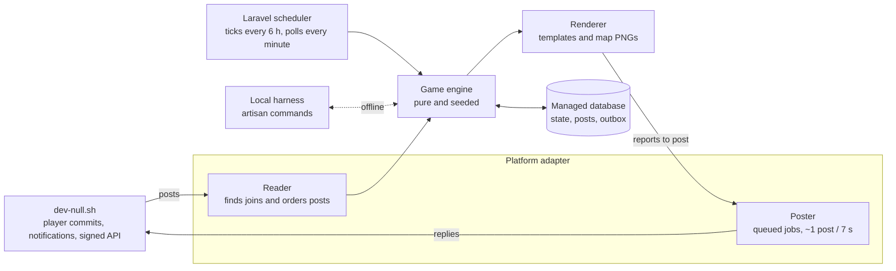

# NULL SPACE: technical design (MVP)

Nov 19, 2026 · @Gary

This document covers how the MVP of NULL SPACE is built and run: a Laravel app hosted on Laravel Cloud (see [Stack and hosting](#stack-and-hosting)). The game itself (rules, orders, economy, what players see) is in the [game design document](gdd.md).

Two principles drive the design:

- **The engine knows nothing about dev-null.sh.** A pure game engine takes orders and returns reports. A thin adapter handles the platform, so the game can be built and balanced offline first.
- **Deterministic.** The same seed, state and orders always give the same result, so every tick can be replayed and tested.

## Architecture

The game engine is a pure function: `resolve(state, orders, tick) → (newState, reports)`, written as plain PHP with no framework dependencies. Everything that talks to dev-null.sh lives in a separate adapter, so the local harness can replace it completely.

The reader and the local harness both feed orders in. Reports go to the renderer and then the outbox. Only the poster spends the 10-posts-a-minute budget.

**Tick resolution order**

1. At the cutoff, take each player's latest visible orders post since the previous tick.
2. Refill every ship's fuel, and move every station price 25% back towards its starting value.
3. Shuffle the players with the seeded RNG for this tick. The order changes every tick, so posting early gives no advantage.
4. Run each player's orders in that order, top to bottom. Moves, harvests and trades take effect immediately, so earlier players move prices and drain fields for later ones. Offers are recorded.
5. Settle accepts in the same order, then expire old offers.
6. In one transaction, save the new state, render every report and add it to the outbox.

**Storage (Laravel Cloud managed database)**

| Table | Holds |
| --- | --- |
| `players` | Handle, log thread root commit, ship name, position, hold, credits, upgrades |
| `hexes` | Only changed hexes: field stock, station prices |
| `charted` | Which hexes each player has seen |
| `order_posts` | Commit ID, player, tick, whether used or superseded |
| `offers` | From, to, both sides, hex, expiry tick |
| `outbox` | Post kind, reply-to commit, body, image, alt text, status, attempts |
| `ticks` | Tick number, seed, resolved time |

**Reliability**

- A tick is resolved once: its number is saved in the same transaction as the new state.
- Outbox rows are keyed by player and tick. The poster marks a row as sent with the returned commit ID, so a restart resumes where it stopped and never double-posts.
- Every processed commit ID is stored, so a post is never read twice.
- The RNG for each tick is seeded from the season seed and the tick number, so any tick can be replayed from a backup.

## Stack and hosting

NULL SPACE is a Laravel app hosted on Laravel Cloud. dev-null.sh is itself a PHP project, so the bot can sign requests the same way the platform verifies them.

| Part | Laravel implementation |
| --- | --- |
| Game engine | Plain PHP classes in `app/Game` with no framework, database or HTTP dependencies, so the engine stays pure and fast to test |
| Tick and polling | The Laravel scheduler: a `ResolveTick` job at each tick time, and a job every minute that checks dev-null.sh for new joins and orders posts |
| Poster | A queued job per outbox row, throttled with Laravel's rate limiting to stay under 10 posts a minute. The outbox row, not the queue, is the source of truth for what has been sent |
| Signing | phpseclib, matching how dev-null.sh verifies SSH signatures. The private key is an environment secret |
| Map images | Drawn with GD or Imagick |
| Database | Laravel Cloud's managed MySQL or Postgres, with migrations for the tables above |
| Local harness | Artisan commands: one to play a turn by hand, one to run scripted players for many ticks |
| Tests | Pest. The engine gets unit tests and replay tests that check a recorded tick resolves identically |

**Laravel Cloud setup**

- Hibernation **off**. A hibernating environment runs no scheduled tasks, queue workers or background processes, so the bot would miss ticks.
- A managed queue for the poster jobs. It scales to zero between ticks.
- A managed database for game state. The app's own disk is not used for anything that must survive a deploy.
- Secrets in environment variables: the bot's SSH private key and the season seed.
- Cost: Laravel Cloud's Starter plan is $5 a month plus usage. Check the [pricing calculator](https://cloud.laravel.com/docs/pricing) with an always-on environment, since hibernation is off.

## Map generation

The map is generated on demand: a hex's contents are a pure function of the season seed and its coordinates, so nothing is stored until something changes.

- **Coordinates:** axial `(q, r)`, flat-top hexes. Directions: `n` (0,−1), `ne` (+1,−1), `se` (+1,0), `s` (0,+1), `sw` (−1,+1), `nw` (−1,0). Distance is the usual axial hex distance, and a hex's ring is its distance from the Hub at (0,0).
- **Generation:** `hash(seed, q, r)` picks the hex's type and properties, using the ring-based chances in the [game design document](gdd.md#the-world). Names come from seeded word lists.
- **Stored changes only:** field stock left, station prices, and which hexes each player has charted. Everything else is regenerated from the seed.
- **Spawn:** a random empty hex in ring 1 or 2, picked with the seeded RNG.

## Bot output implementation

- All bot text comes from templates with a few seeded variants each. No language model writes posts, since dev-null.sh's rules ban AI-generated posts.
- Posts must fit 4,000 characters, up to three images of 10 MB each, and image descriptions of up to 1,000 characters. The renderer truncates scan lists rather than splitting a report into two posts.
- The map image is drawn server-side as a PNG with GD or Imagick, centred on the ship and about 9 hexes across. Its alt text is generated from the same data that draws the map.
- Every post gives the next tick as a countdown and a UTC time, computed when the post is rendered.

## Bot account

The bot is an ordinary dev-null.sh account, so it needs its own GitHub user account: dev-null.sh only offers GitHub sign-in, and a profile's handle appears to come from the GitHub username.

1. Create a GitHub user account for the bot. GitHub allows each person one free machine account.
2. Sign in to dev-null.sh with it once, to create the profile.
3. Generate an SSH key on the server that runs the bot and approve it at `/mobile/authorize`, so the bot can make signed API requests.

The handle is still open. A GitHub organisation can't sign in to dev-null.sh, and organisations and users share one namespace on GitHub. So while the `nullspacebot` organisation exists, no user account can be called `nullspacebot`. Either rename the organisation and give its name to the bot's user account, or keep the organisation and pick another name for the bot, such as `nullspace`, if it's free.

## Platform constraints and open questions

The bot's 10 posts a minute is the hard limit, and it shapes the tick design. These figures come from dev-null.sh's [knowledge base](https://github.com/dev-null-sh/dev-null.sh/blob/production/KNOWLEDGE_BASE.md#public-read-api-and-atom-feeds).

| Limit | Value | What it means for NULL SPACE |
| --- | --- | --- |
| Posting (commits, replies, quotes) | 10 per minute per user | About 600 bot posts an hour. 500 active players' reports take about 50 minutes to go out after a tick |
| Signed API | 120 requests per minute per user | The budget for reading notifications and posting |
| Public read API | 60 requests per minute per IP, no auth | Fallback for reading players' replies. 20 commits per page |
| Post length | 1–4,000 characters, up to 3 images | Caps report length |
| Moderation | Some posts need human review before they're visible | Orders and bot posts can be delayed by an unknown amount |
| Content rules | No AI-generated posts, spam, engagement bait or low-effort posts | Bot text is templated. Orders posts with no other text could look low-effort |

Open questions:

- [ ] Choose the bot's handle and create its GitHub user account (see Bot account).
- [ ] Get the maintainers' OK, and ask whether @nullspace can be auto-approved by moderation.
- [ ] Find the signed API route for reading notifications. The docs say it exists but don't list it.
- [ ] Check whether commit JSON includes a parent or root ID, so the bot can tell a reply belongs to a player's log thread.
- [ ] Check whether commit JSON includes a created time distinct from approval time, to decide which counts against the tick cutoff.
- [ ] Confirm how the bot uploads an image and its description through the signed API.
- [ ] Confirm which of GD and Imagick Laravel Cloud's PHP image includes.
- [ ] Choose MySQL or Postgres. Either works; nothing in the design depends on the choice.

## Build plan

Build the game offline first, and connect it to dev-null.sh only once it's fun in the local harness.

1. **Engine and map generation.** Seeded hexes, ships, every order, prices, fields, events and trades. Done when unit tests cover every order and its failure cases, and replaying a tick gives identical results.
2. **Local harness.** Artisan commands to play several simulated players from the terminal, with text reports and the map saved as PNG. Done when a three-player game can be played for 20 ticks by hand.
3. **Balance pass.** Script bot players (a trader, an explorer, a harvester) and run 200 ticks. Done when no single strategy clearly dominates and a typical player can afford their first upgrade within about 8 ticks.
4. **Platform reader.** Detect joins and orders posts on dev-null.sh, store them, and feed them to the engine without posting. Done when a dry run against real posts produces correct reports locally.
5. **Platform poster.** Rate-limited outbox, welcome replies, turn reports with images, daily bulletin. Done when a closed test with 5–10 friends runs a week without double posts or missed reports.
6. **Open launch.** One season, reset by hand.
